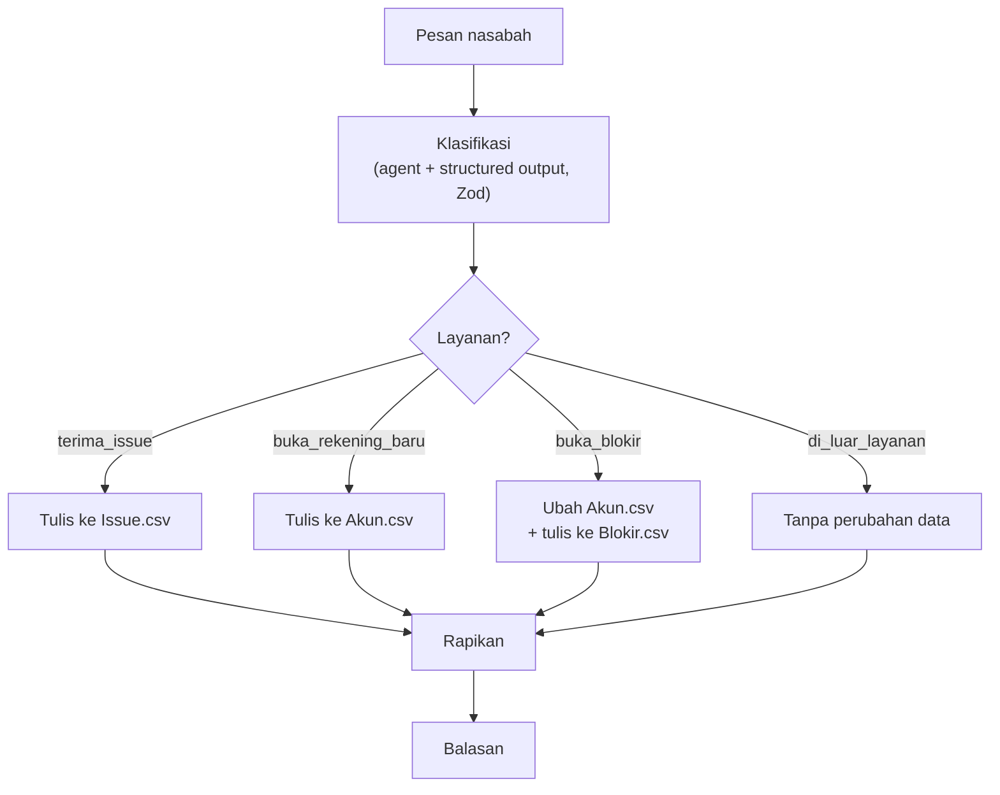

# mastra-cs-bank

Agen customer service bank sederhana yang dibangun dengan [Mastra](https://mastra.ai). Pesan nasabah diklasifikasikan oleh LLM menjadi salah satu dari tiga layanan, lalu diproses oleh workflow dan hasilnya disimpan ke file CSV.

Dibuat sebagai tugas belajar Mastra di magang AI Engineer, DOT Indonesia.

## Layanan

| Layanan | Yang dilakukan | Data yang disimpan |
|---|---|---|
| Terima issue | Mencatat keluhan nasabah sebagai tiket | `data/Issue.csv` |
| Buka rekening baru | Membuat akun baru (menolak jika no. HP sudah terdaftar) | `data/Akun.csv` |
| Buka blokir | Memeriksa akun berdasarkan no. HP dan nama, lalu mengubah status dari `diblokir` menjadi `aktif` | `data/Akun.csv`, `data/Blokir.csv` |

Pesan di luar tiga layanan itu, atau yang keyakinan modelnya di bawah 0,6, dijawab sebagai "di luar layanan" tanpa mengubah data apa pun. Jika data yang dibutuhkan belum lengkap (nama, no. HP, atau ringkasan masalah), workflow membalas dengan permintaan untuk melengkapinya.

## Alur



Keluaran LLM bertipe aman: agent dipaksa mengembalikan objek yang sesuai skema Zod di `src/mastra/schemas/layanan.ts`, sehingga langkah berikutnya menerima data bertipe (TypeScript) dan bukan teks bebas.

## Teknologi

- Mastra (`createWorkflow`, `createStep`, `.branch()`, `Agent`)
- Zod + TypeScript
- Google Gemini lewat model router Mastra (tier gratis)
- papaparse untuk baca/tulis CSV

## Struktur

```
src/mastra/
  index.ts                    registrasi workflow dan agent
  agents/agen-klasifikasi.ts  agent klasifikasi
  schemas/layanan.ts          skema Zod hasil klasifikasi
  storage/csv-store.ts        baca/tulis CSV (lapisan penyimpanan)
  workflows/cs-workflow.ts    workflow utama
  workflows/workflow.ts       workflow contoh awal
data/
  Akun.csv  Issue.csv  Blokir.csv
```

Penyimpanan sengaja dipisah di `csv-store.ts` supaya mudah diganti ke Google Sheets tanpa mengubah isi workflow.

## Cara menjalankan

Prasyarat: Node.js 20.19 atau lebih baru.

```bash
npm install
cp .env.example .env
```

Isi `.env`:

```
GOOGLE_GENERATIVE_AI_API_KEY=isi_api_key_kamu
DATA_DIR=./data
```

API key gratis bisa dibuat di [Google AI Studio](https://aistudio.google.com).

```bash
npm run dev
```

Buka Mastra Studio di `http://localhost:4111`, pilih workflow `csWorkflow`, lalu isi input:

```json
{ "pesan": "Halo, saya Budi Santoso, tolong buka blokir kartu saya. No HP 081234567890" }
```

Lihat perubahan pada file di folder `data/`.

## Contoh pesan untuk dicoba

- "Saya Sari Dewi, 081298765432, aplikasi mobile banking saya error saat transfer" (terima issue)
- "Saya mau buka rekening baru, nama Rina Putri, no HP 081200000010" (buka rekening)
- "Saya Budi Santoso, 081234567890, kartu saya terblokir, tolong dibuka" (buka blokir)
- "Berapa kurs dolar hari ini?" (di luar layanan)

## Catatan

- **Data contoh:** isi `data/Akun.csv` hanya data fiktif untuk uji coba. Pastikan tiap no. HP unik, karena pencocokan akun memakai no. HP.
- **Model:** nama model Gemini sering berganti dan kadang kena batas kuota (error 429) atau sibuk (503). Model diatur di `src/mastra/agents/agen-klasifikasi.ts`.
- **Berbagi Studio:** Studio mode `mastra dev` menyimpan alamat API `localhost:4111`, jadi tidak bisa dibuka dari luar lewat ngrok atau port forwarding (diblokir CORS). Untuk demo, jalankan secara lokal.

## Rencana berikutnya

- Ganti penyimpanan CSV ke Google Sheets (3 tab: Akun, Issue, Blokir)
- Suspend/resume untuk menanyakan kembali data yang belum lengkap (butuh storage seperti `@mastra/libsql`)
- Persetujuan manusia sebelum membuka blokir
